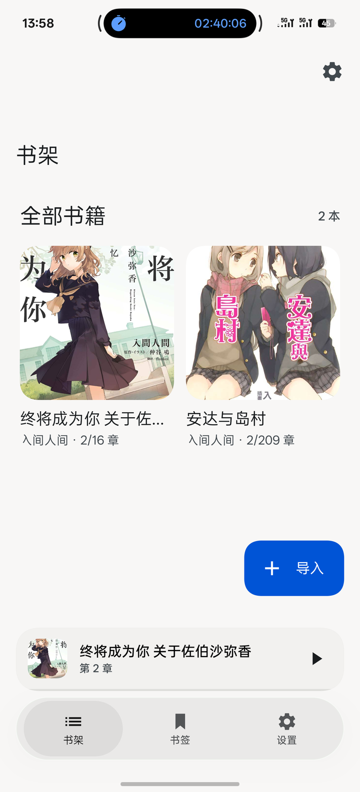
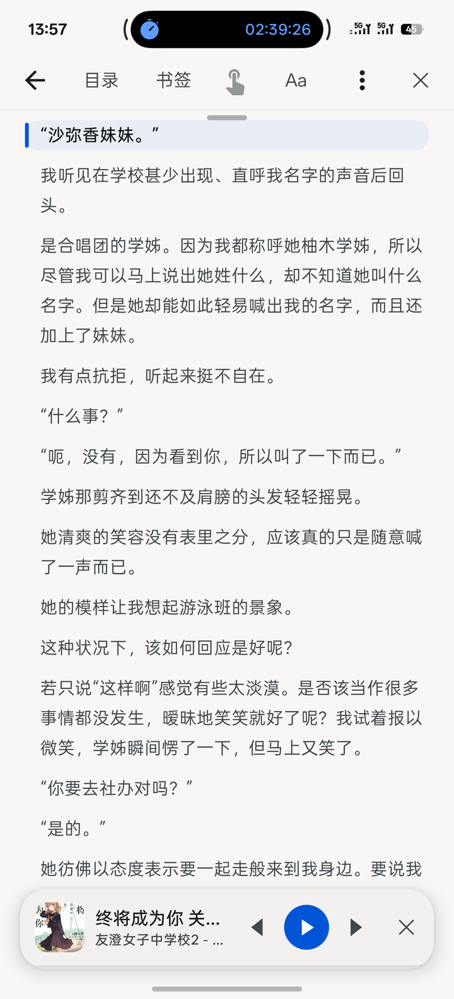
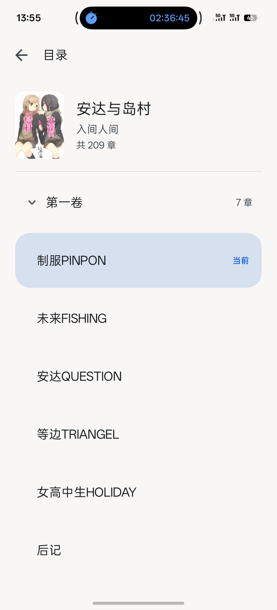

# 书声 · BookVoice

> 风声雨声读书声，声声入耳。

**书声（BookVoice）** 是一个 Android 本地听书 App：把 TXT / EPUB 导入书库，用你自己配置的云端 TTS 连续朗读；也可以当成阅读器，滚动看正文和插图，点哪句就从哪句开始听。

没有账号，没有服务端，没有云同步。书只在本机解析、保存，只有待朗读的文字片段会发送给你选择的 TTS 供应商。

<p align="center">
  <a href="https://github.com/MungBean2435/BookVoice/releases/latest"></a>
  <a href="https://github.com/MungBean2435/BookVoice/actions/workflows/android.yml"></a>
  <a href="LICENSE"></a>
</p>

<p align="center"></p>

## 它是什么

- **听书**：两家云端 TTS，按段落连续朗读，支持后台播放、锁屏控制、定时关闭。
- **阅读器**：TXT / EPUB 排版成连续正文，保留插图；当前朗读段高亮，点句起听。
- **本地书库**：导入、封面、书签、进度、缓存都在本机；API Key 只存在应用私有目录。
- **纸感界面**：Jetpack Compose、动态取色、浮动导航胶囊、液态玻璃与页面变形。

## 界面

<p align="center">
  
  
</p>
<p align="center"><sub>书架 · 阅读页与操作栏（点句起听、目录、书签、Aa、菜单）</sub></p>

<p align="center">
  
  
</p>
<p align="center"><sub>分卷目录 · 播放设置（进度、语速、音色、定时、缓存本章）</sub></p>

## 功能

### 导入与书库

- TXT（UTF-8 / GBK 自动识别）与 EPUB（按 spine 解析，保留插图与封面）。
- 单本导入；引导页可选择整个文件夹批量导入。导入过程是一张可操作的任务卡：`n/m` 进度、当前文件名、失败原因、逐本重试、停止导入。
- 书架按最近阅读排列，长按删除有二次确认；找不到书时可以直接从空态导入。
- 书签跨书聚合，点一条从原段继续；删除后可在 Snackbar 里撤销。
- 每个 tab 各自保留滚动位置。

### 阅读与目录

- 全书一个连续列表，章与章之间直接滑过去，不用退出再进。
- 目录页是一张完整的书页：顶部封面、书名、作者、章节数；有分卷时按卷折叠，当前卷自动展开，当前章高亮并滚动到可见位置。
- EPUB 优先读 EPUB3 `nav` / EPUB2 `NCX` 的层级目录；没有目录信息时从章节标题兜底。TXT 识别「第 X 卷 / 部 / 篇 / 集」等卷标题。
- 阅读进度按章、段记录；暂停或纯手动阅读 700ms 后也会落库，下次从上次的位置继续。
- 阅读字号可调；点正文任意一句，从该句开始朗读。

### 朗读

- 两家 TTS：**小米 MiMo**（wav，支持 PCM 流式）与 **MiniMax**（mp3）。每家可存多套配置，列表里切换启用。
- 每个配置可保存多个模型 / 音色；支持内置目录和账号在线目录，在线获取失败自动回落到内置列表。
- 合成按块进行：首块 ≤150 字，后续目标 400 字，跨段合并，对话体不会一段一停。
- MiMo 每块边收边播，首包通常 1 秒左右到达；MiniMax 走整块合成。
- 播放当前块时预取下一块，章末提前预取下一章。
- 断网不跳段：进入等待（最多 10 分钟），网络恢复后继续；合成失败会区分 Key 错误、限流、超长，Key 错不反复重试。
- 失败块跳过并记入「待补段落」，可以逐条跳转或删除；播放错误会留下常驻提示条，可手动重试或关闭。
- 朗读规则内置省略号、破折号、百分号、摄氏度等清理；支持导入自定义 JSON 规则包。
- 语速、音色、定时关闭（15 / 30 / 45 / 60 分钟）在播放面板里调；睡眠倒计时实时更新。

### 播放与缓存

- Media3 ExoPlayer 前台服务播放，通知栏 / 锁屏控制播放暂停、上一段、下一段。
- 进度按段落记录，退出重进回到上次位置。
- 音频按内容寻址缓存，重听不再请求；默认上限 512 MB，可在设置里调，按最久未使用清理。
- 「缓存本章」显示 `n/m` 进度，可随时停止；完成后提示成功或失败段数，失败的段下次仍可重试。

### 备份与诊断

- 备份导出 / 导入：阅读进度、书签、朗读规则、设置；**不含**书文件和 API Key。
- 导入是合并式的：只更新本机已有的书，本机没有的书跳过并提示，不会清空现有书库。
- 设置 → 诊断：结构化播放事件（等级 / 标签），可按播放、合成、网络、问题筛选；顶部有设备、版本、供应商、模型、缓存等概览。
- 诊断支持复制摘要、导出文本、记录标记、清空；导出内容经过脱敏，不含 API Key、服务地址、书名和正文。

### 界面

- 动态取色，取不到时用墨蓝主色兜底；暖白 / 墨黑纸感主题。
- 底部浮动胶囊（书架 / 书签 / 设置），选中态 260ms 平移，点按 haptic。
- 液态玻璃三档降级：边缘折射 / 毛玻璃 / 纯色。
- 可拖拽 tab 镜头：按住选中的胶囊拖动切换 tab，松手弹到最近的 tab。
- 页面变形转场、返回手势预览、设置搜索、引导页。

## 版本与环境

| 项 | 值 |
|---|---|
| 当前版本 | 3.4.0（versionCode 72） |
| 最低系统 | Android 8.0（API 26） |
| 编译 / 目标 SDK | 35 |
| 语言 / UI | Kotlin + Jetpack Compose（BOM 2024.10.01） |
| 播放 | Media3 ExoPlayer 1.5.0 |
| 存储 | 原生 SQLite（SQLiteOpenHelper） |
| 许可 | MIT |

## 下载

到 [GitHub Releases](https://github.com/MungBean2435/BookVoice/releases/latest) 下载最新 APK。

- 覆盖安装需要与已装版本使用同一签名；仓库默认的 release 构建在没有 `keystore.properties` 时会回退 debug 签名。
- 旧版「听书」（`io.github.mungbean2435.tingshu`）与新版包名不同，可以并存。迁移方式：旧版「备份导出」→ 新版「备份导入」，书文件需要重新导入。
- 当前版本的目录支持分卷，但**旧书库里的书没有卷信息**；需要重新导入才能在目录里看到分卷。旧版 TXT 导入时被丢弃的空卷标题也无法恢复。

## 从源码构建

需要 JDK 17 与 Android SDK（platform 35 / build-tools 35）。

```bash
export JAVA_HOME=/path/to/jdk17
export ANDROID_HOME=/path/to/android-sdk

./gradlew testDebugUnitTest      # 单元测试
./gradlew assembleDebug          # app/build/outputs/apk/debug/app-debug.apk
./gradlew assembleRelease        # app/build/outputs/apk/release/
```

国内网络建议走镜像；仓库的 `settings.gradle.kts` 已配置阿里云 Maven 镜像，Google / MavenCentral 作为兜底。

**签名**：`release` 会读取仓库根目录的 `keystore.properties`；没有这个文件时自动回退 debug 签名，方便本地覆盖安装、保留数据。要分发请自己生成 keystore：

```properties
# keystore.properties（不要提交）
storeFile=/path/to/release.jks
storePassword=******
keyAlias=bookvoice
keyPassword=******
```

在 arm64 Linux 上构建会遇到 aapt2 无法执行的问题，见 [docs/BUILD-ON-DEVICE.md](docs/BUILD-ON-DEVICE.md)。

## 项目结构

```
app/src/main/java/io/github/mungbean2435/bookvoice/
├─ ui/         Compose 界面：书架、正文、目录、播放、书签、设置、导航、液态玻璃
├─ data/       SQLite、TXT / EPUB 解析（含分卷）、书库仓储、设置、备份、诊断
├─ tts/        TTS 供应商（MiMo / MiniMax）、分块、规则包、音色目录
└─ playback/   前台服务、ExoPlayer 播放内核、流式音频、进度与缓存
```

包名 `io.github.mungbean2435.bookvoice`。从旧名「听书」（`io.github.mungbean2435.tingshu`）迁过来时 applicationId 变了，两者是独立 App：数据不会自动继承，在旧版里「备份导出」，到新版「备份导入」，进度 / 书签 / 设置可以搬过来（书文件要重新导入）。

## 数据与隐私

- 书籍内容只在本机解析与存储，不上传服务器；没有账号，也没有统计 SDK。
- 文字片段会发送到你**自己配置**的 TTS 供应商（MiniMax / 小米 MiMo），用你自己的 Key 计费，请阅读对应服务条款。
- TTS Key 存在本机私有目录（SharedPreferences），不进日志、不进备份、不进仓库。
- `android:allowBackup="false"`，应用数据不进系统备份。
- 诊断导出只含版本、设备、配置名和播放事件，不含 Key、服务地址、书名和正文。
- release 签名文件与 `keystore.properties` 已在 `.gitignore` 中。

## 已知限制

- 需要联网使用云端 TTS；没有内置离线语音，也没有内置免费额度。
- 不支持 DRM EPUB、固定版式（fixed-layout）EPUB 和 PDF。
- 目录分卷依赖导入时解析出的卷信息；旧书需要重新导入。
- 目前只有 Android 端，没有 iOS / 桌面端，也不在应用商店上架。
- 朗读高亮按播放进度估算，和真实发音位置可能有约一秒误差。

## 文档

- [项目文档](docs/PROJECT.md)：架构、数据模型、播放内核、供应商接入
- [版本历史](docs/CHANGELOG.md)
- [页面状态与统一返回](docs/NAV-STATE.md)
- [浮动胶囊与液态玻璃](docs/NAV-GLASS-2.6.md)
- [可拖拽 tab 镜头](docs/TAB-LENS-2.7.md)
- [规则包格式](docs/RULES.md)
- [arm64 环境构建](docs/BUILD-ON-DEVICE.md)

`docs/design/` 是开发过程中的设计笔记与提示词，部分早期文档仍用旧名「听书」。

## 致谢

- [Jetpack Compose](https://developer.android.com/jetpack/compose)、[Media3](https://github.com/androidx/media)、[jsoup](https://jsoup.org/)
- 阅读页的部分交互思路来自开源阅读器 [Readest](https://github.com/readest/readest)，仓库中不含其代码

## 许可

[MIT](LICENSE) © 2026 MungBean2435

只用于导入你有权使用的内容；TTS 服务由各自的供应商提供，与本项目无关。

---

## English

**BookVoice / 书声** is a local-first Android audiobook player and reader. Import TXT or EPUB, and it reads the book aloud through a TTS provider you configure (Xiaomi MiMo or MiniMax). The reader keeps the whole book in one continuous scroll, highlights the current sentence, and lets you tap any sentence to start listening from there.

- **Library** — TXT (UTF-8/GBK) and EPUB with covers and images; cancellable batch import with per-file retry; bookmarks with undo.
- **Contents** — cover/title/author header, collapsible volume groups parsed from EPUB nav/NCX or TXT volume headings, current chapter highlighted and scrolled into view.
- **Playback** — MiMo PCM streaming per chunk, chunk-level prefetch, background playback and lock-screen controls, sleep timer, resume by paragraph, content-addressed audio cache with a configurable limit.
- **Resilience** — network waits instead of skipping, per-chunk retry, a persistent error banner with manual retry, and a diagnostics panel with sanitized export.
- **Privacy** — books stay on device; only text chunks go to the TTS provider you choose, billed to your own key. No accounts, no analytics, `allowBackup="false"`.

Requires Android 8.0+ (API 26). Build with JDK 17 and Android SDK 35:

```bash
./gradlew testDebugUnitTest
./gradlew assembleDebug
```

License: MIT. See [Releases](https://github.com/MungBean2435/BookVoice/releases/latest) for the latest APK.
